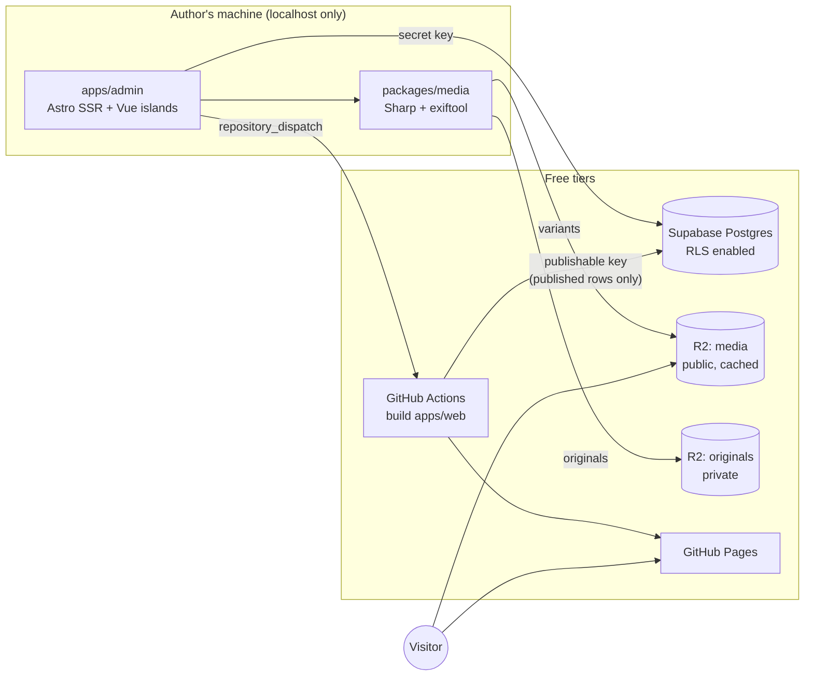

# blog-soy1limon

A personal, bilingual (English / Spanish) blog that costs nothing to run beyond the domain.

- **Public site**: static [Astro](https://astro.build) build on GitHub Pages. Zero JavaScript by default,
  accessible (WCAG 2.2 AA) and built for search engines (structured data, sitemaps, `hreflang`).
- **Admin**: runs only on the author's machine. Writes posts, uploads photos, edits image metadata.
- **Content**: Supabase Postgres with Row Level Security; the public build can only read published posts.
- **Images**: converted locally to responsive WebP with optional watermark and correct embedded
  metadata (creator, copyright, license, alt text; location kept or removed per photo), served from
  Cloudflare R2.

## Architecture



## Repository layout

| Path                | Purpose                                                    |
| ------------------- | ---------------------------------------------------------- |
| `apps/web`          | Public static site                                         |
| `apps/admin`        | Local-only admin panel                                     |
| `packages/core`     | Shared zod schemas, site configuration, pure helpers       |
| `packages/db`       | Supabase clients, typed queries, offline fixtures          |
| `packages/media`    | Image pipeline and CLI                                     |
| `packages/markdown` | Markdown pipeline shared by the site and the admin preview |
| `supabase`          | Database migrations and local stack config                 |
| `docs`              | Roadmap, setup guide, architecture decisions               |

## Getting started

Requirements: Node.js 24 (see `.node-version`), pnpm 11, Docker, and [gitleaks](https://github.com/gitleaks/gitleaks)
(required by the pre-commit hook). Full instructions: [`docs/setup.md`](docs/setup.md).

```sh
pnpm install      # also installs git hooks
pnpm lint
pnpm typecheck
pnpm test
```

## Documentation

- [Roadmap](docs/roadmap.md) — phased implementation plan and requirements
- [Setup](docs/setup.md) — local environment, Supabase, and later cloud services
- [Content model](docs/content-model.md) — tables, rules, and who can read what
- [Media pipeline](docs/media-pipeline.md) — formats, variants, watermark, metadata, storage
- [Admin](docs/admin.md) — running the local admin, its security model and the upload flow
- [Public site](docs/site.md) — URLs, how content becomes pages, search and tests
- [Themes](docs/themes.md) — how the visual themes work, the markup contract, adding a theme
- [Accessibility](docs/accessibility.md) — what is checked automatically, the manual checklist, known limitations
- [SEO, analytics and environments](docs/seo.md) — meta tags, structured data, sitemap, Search Console, visit counting
- [Operations](docs/operations.md) — deploys, scheduled posts, backups, key rotation, free-tier limits
- [Architecture decisions](docs/adr/README.md) — why the project is built this way
- [Security policy](SECURITY.md)

## License

The **source code** is released under the [MIT License](LICENSE).
The **blog content and images** (posts, photos, and their metadata) are **not** covered by that
license; all rights reserved unless a post states otherwise.
