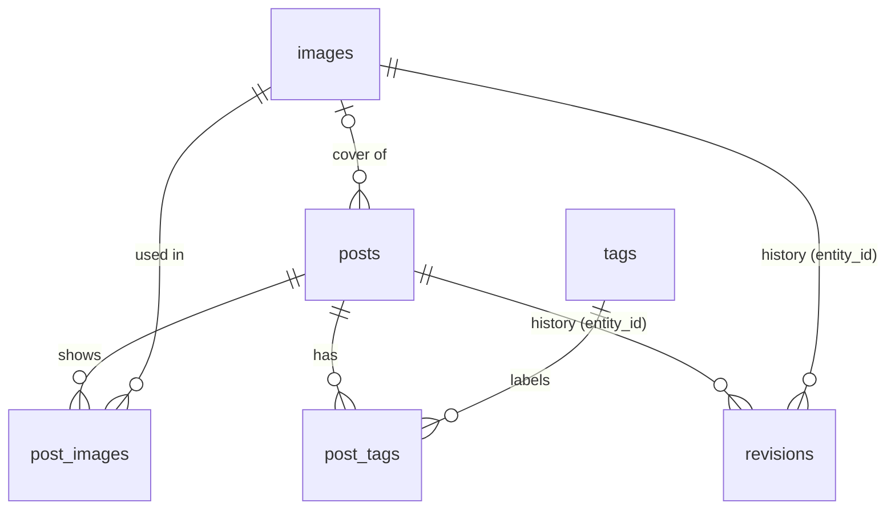

# Content model

All content lives in Supabase Postgres. The schema is defined by the migrations in
`supabase/migrations/`; TypeScript types are generated from it into
`packages/db/src/database.types.ts` (`pnpm db:types`).

## Entities

| Table         | Purpose                                                                                                                              |
| ------------- | ------------------------------------------------------------------------------------------------------------------------------------ |
| `posts`       | One row per **language version** of a post (`lang` = `en` or `es`).                                                                  |
| `tags`        | Shared tags with per-language labels (`{"en": "Travel", "es": "Viajes"}`).                                                           |
| `post_tags`   | Many-to-many between posts and tags.                                                                                                 |
| `images`      | Uploaded photos: SEO name, dimensions, WebP variants, embedded metadata, per-language alt text and caption.                          |
| `post_images` | Gallery images (ordered by `position`) and images referenced inline in the Markdown body. The cover image is `posts.cover_image_id`. |
| `revisions`   | Snapshots of posts and image metadata for history and restore. The newest 50 per entity are kept.                                    |

## Rules the database enforces

These hold no matter which code writes the data:

- **Slugs**: `^[a-z0-9]+(-[a-z0-9]+)*$`, at most 80 characters, unique per language (`unique (lang, slug)`).
  The same slug may exist once in English and once in Spanish.
- **Publishing**: a `published` post must have `published_at`, a title and a description.
- **Scheduling**: a `published` post with a future `published_at` stays invisible to the public
  until that moment. The daily build picks it up (phase 7).
- **Translations**: posts sharing a `translation_key` are translations of each other. A group can
  hold at most one post per language. Used for `hreflang` links.
- **Old URLs**: when a published post changes slug, the old one goes to `previous_slugs` and keeps
  redirecting. The admin treats both current and previous slugs as taken.
- **Images in use cannot be deleted**: foreign keys from `posts.cover_image_id` and `post_images`
  use `on delete restrict`.
- **Ready means complete**: an image can only be `ready` once it has dimensions and at least one variant.
- **jsonb shape**: `variants` must be an array; `metadata`, `alt`, `caption` and `labels` must be objects.
  The exact structure is validated with zod in `packages/core/src/content.ts`.
- **Revision retention**: a trigger keeps the newest 50 revisions per entity.

## Who can see what

|                            | Local admin (secret key) | Public build (publishable key, `anon` role)                                                                                                                         |
| -------------------------- | ------------------------ | ------------------------------------------------------------------------------------------------------------------------------------------------------------------- |
| `posts`                    | everything               | only `status = 'published'` and `published_at <= now()`                                                                                                             |
| `tags`                     | everything               | all tags                                                                                                                                                            |
| `post_tags`, `post_images` | everything               | only links of visible posts                                                                                                                                         |
| `images`                   | everything               | only `ready` images used by visible posts, and only the public columns: `id, seo_name, width, height, dominant_color, variants, metadata, alt, caption, updated_at` |
| `revisions`                | everything               | nothing                                                                                                                                                             |
| writes, RPC functions      | allowed                  | denied                                                                                                                                                              |

Requesting `select *` or a private column (`original_key`, `original_filename`, …) of `images` with
the publishable key fails with `permission denied`. Queries must therefore list columns explicitly;
see `PUBLIC_IMAGE_COLUMNS` in `packages/db/src/content/supabase-source.ts`.

The `authenticated` role has no grants at all: the project has no users and sign-ups are disabled.

## Transactional helpers

PostgREST runs one statement per request, so multi-step changes go through SQL functions that only
the secret key may execute:

- `set_post_tags(post_id, tag_ids[])` replaces the tags of a post.
- `sync_post_images(post_id, gallery[], inline[])` replaces image links. Array order is the gallery order.

## Code entry points (`packages/db`)

| Import                | For              | Main functions                                                                                                                           |
| --------------------- | ---------------- | ---------------------------------------------------------------------------------------------------------------------------------------- |
| `@soy1limon/db`       | Public build     | `loadPublishedContent(env)` returns `{ posts, tags, images }` from Supabase **or** offline fixtures (`CONTENT_SOURCE`)                   |
| `@soy1limon/db/admin` | Local admin only | `createAdminClient`, post/tag/image/revision queries, `isPostSlugAvailable`, `isSeoNameAvailable`, `deleteImage` (refuses images in use) |

Every row read for the public build is validated with zod. An invalid row stops the build instead of
publishing a broken page.

## Changing the schema

1. `pnpm exec supabase migration new <name>` and write the SQL.
2. `pnpm db:reset` applies all migrations and the seed to the **local** stack.
3. `pnpm db:types` regenerates the TypeScript types (CI fails if they are stale).
4. `pnpm test:integration` checks RLS and queries against the local stack.
5. `pnpm db:push` applies pending migrations to the real project. Run `pnpm db:backup` first.

Never edit a migration that has already been pushed; add a new one instead.
