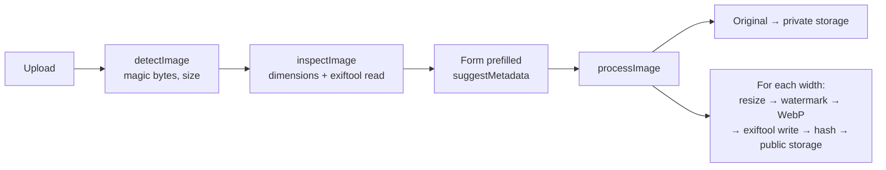

# Media pipeline

`packages/media` turns any uploaded photo into responsive, watermarked WebP files that carry the
right metadata. Nothing in it talks to the database: the admin stores the result.



## Steps

1. **Intake** (`intake.ts`): the type is decided by the file's bytes, never by its name or the browser.
   - Accepted: JPEG, PNG, WebP, AVIF, TIFF, GIF (first frame) and HEIC/HEIF. Maximum 100 MB, plus Sharp's pixel limit against decompression bombs.
   - A text file named `photo.jpg` is rejected. A PNG renamed to `.jpg` is accepted **as a PNG**: renaming happens innocently all the time, and the content decides.
2. **Decode** (`decode.ts`): Sharp opens the image and applies the EXIF orientation.
   - iPhone HEIC uses HEVC, which Sharp's prebuilt binaries cannot decode (patent licensing). Those files fall back to `heic-decode` (libheif compiled to WebAssembly).
3. **Inspect** (`pipeline.ts → inspectImage`): exiftool reads EXIF, IPTC and XMP, and `normalizeTags` maps them to one shape (`EmbeddedMetadata`), preferring XMP, then IPTC, then EXIF. `suggestMetadata` prefills the form:
   - Values found in the file win.
   - Site defaults (`packages/core/src/site-config.ts`) fill the gaps. `{year}` in the copyright becomes the capture year.
   - Camera info is kept and location is dropped, unless the defaults say otherwise.
   - The SEO name is suggested from the title, or else the file name.
4. **Variants** (`render.ts`): the configured widths `[400, 800, 1200, 1600, 2000]`, with three rules:
   - Never upscale.
   - An image narrower than 2000 px adds its own width as the largest.
   - WebP at quality 80, effort 5, and transparency is preserved.
5. **Watermark** (`watermark.ts`): an SVG text overlay composited onto public variants only; the original stays clean.
   - Size and margin are relative to the variant width, with a minimum font size, so it looks the same at every size.
   - The text is XML-escaped.
6. **Metadata** (`metadata/write.ts`): written by exiftool **after** encoding, because Sharp strips everything. See the mapping below.
7. **Keys and upload** (`keys.ts`): `images/{year}/{seo-name}-{hash8}-{width}.webp`, where `hash8` comes from the final bytes.
   - Variants go to the public bucket with `Cache-Control: public, max-age=31536000, immutable`.
   - The untouched original goes to the private bucket as `originals/{id}.{ext}`.
   - If any step fails, everything uploaded in that call is deleted again.

## Metadata mapping

WebP supports EXIF and XMP (not IPTC-IIM), so every field is written to both where possible.

| Form field             | Tags written                                                                  | Profile                           |
| ---------------------- | ----------------------------------------------------------------------------- | --------------------------------- |
| Creator                | `XMP-dc:Creator`, EXIF `Artist`                                               | compact + full                    |
| Copyright notice       | `XMP-dc:Rights`, EXIF `Copyright`                                             | compact + full                    |
| Credit line            | `XMP-photoshop:Credit`                                                        | compact + full                    |
| License URL            | `XMP-xmpRights:WebStatement`, `XMP-plus:LicensorURL`                          | compact + full                    |
| Title                  | `XMP-dc:Title`, EXIF `XPTitle`                                                | full                              |
| Description            | `XMP-dc:Description`, EXIF `ImageDescription`                                 | full                              |
| Keywords               | `XMP-dc:Subject`, EXIF `XPKeywords`                                           | full                              |
| Date taken             | EXIF `DateTimeOriginal` + `OffsetTimeOriginal`, `XMP-photoshop:DateCreated`   | full                              |
| Alt text               | `XMP-iptcCore:AltTextAccessibility` (IPTC 2021 accessibility field)           | full                              |
| Camera, lens, exposure | `Make`, `Model`, `LensModel`, `FocalLength`, `FNumber`, `ExposureTime`, `ISO` | full, only if kept                |
| Location               | `GPSLatitude`, `GPSLongitude`, `GPSAltitude` (signed)                         | full, **only if explicitly kept** |
| (always)               | EXIF `ColorSpace = sRGB`                                                      | compact + full                    |

**Profiles.** Variants of 1200 px and wider (the ones people open and download) get the **full**
set. Smaller variants get the **compact** set: authorship, copyright and license only.

**Size.** exiftool reserves about 2 KB of XMP padding for in-place edits by default. We write with
`-api Compact=All`, which removes it.

| Profile | Overhead | Share of a 400 px variant (~20 KB) |
| ------- | -------- | ---------------------------------- |
| Full    | ~1.9 KB  | —                                  |
| Compact | ~1 KB    | ~5 %                               |

Tests enforce budgets of 2.5 KB (full) and 1.5 KB (compact).

**GPS.** A file's location is shown in the form but **removed by default**. Keeping it is an explicit
choice per image.

Coordinates are written as signed decimals. exiftool-vendored derives the hemisphere references from
the sign. Writing absolute values plus `West`/`South` gets silently flipped, and a test covers this.

## Why content-addressed keys

Immutable caching lets browsers and Cloudflare keep images for a year without revalidating, which
is where most of the transfer savings come from. That is only safe if a URL never changes content.
Hashing the final bytes guarantees it: changing the watermark, metadata or SEO name produces new
keys. `reprocessImage` renders from the stored original. The old keys are moved to
`images.retired_keys` by the admin and deleted only on an explicit clean-up, so cached pages and
Google Images links keep working.

## Storage drivers

| Driver     | Public files                                                    | Private originals                               | Use                     |
| ---------- | --------------------------------------------------------------- | ----------------------------------------------- | ----------------------- |
| `local-fs` | `<root>/public/<key>` (served by the admin at `MEDIA_BASE_URL`) | `<root>/private/<key>`                          | Development, tests, CLI |
| `r2`       | bucket `R2_MEDIA_BUCKET` behind the custom domain               | bucket `R2_ORIGINALS_BUCKET` (no public access) | Production              |

Keys are validated (`assertSafeKey`) so nothing can escape the storage root.

## CLI

Runs the exact pipeline locally and uploads nothing:

```sh
pnpm media process ~/Pictures/IMG_1234.HEIC --out media-out --alt "Sunset over Monterrey"
pnpm media --help
```

It prints a JSON summary. That summary includes whether the file had GPS data, whether the output
kept it, the embedded metadata, and every variant with its size. `media-out/` is git-ignored.

## Tests

`pnpm test` runs the pipeline end to end against images generated at test time (no binary blobs or
personal photos in the repo):

- Orientation 6 is applied.
- No upscaling. The panorama gets every width; the 300 px image gets one variant.
- Output is real WebP under the expected keys.
- GPS is removed by default and kept with the correct sign on request.
- Each variant gets the right profile, within the metadata size budget.
- The watermark is visible only in its corner (pixel diff).
- Transparency is preserved.
- A lying extension is rejected.
- Uploads are rolled back on failure.
- Reprocessing produces new keys without re-uploading the original.
- The CLI works.

**HEIC.** No HEVC encoder is available to generate a sample, so the HEIC test uses a real iPhone
photo committed at `packages/media/test/assets/sample.heic`. It is stored landscape with a 90° HEIF
rotation, so the test also checks that rotation is applied.

That sample was stripped with `exiftool -all=` before being committed. EXIF, XMP, GPS, date and
maker notes are gone. Only Apple's HDR tone-mapping data remains, and it reveals no location or
identity. **Any photo added to the repo must be stripped the same way first.**
